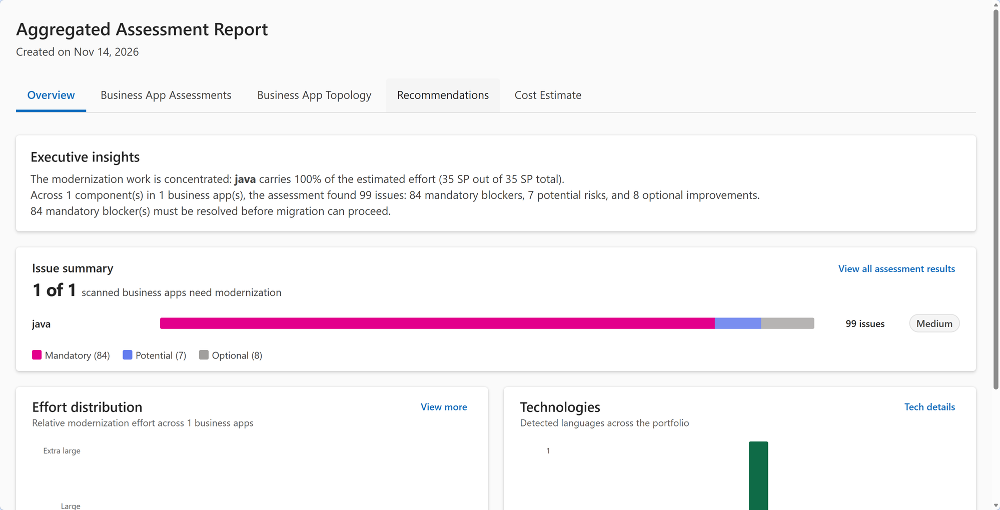

# 2. 평가하고 계획 승인하기

[전체 목차](../../README.md) | [Java 목차](README.md) | [이전: 원본 실행](01-run-locally.md) | [다음: 업그레이드](03-upgrade.md) | [문제 해결](08-troubleshooting.md)

## 목표

앱 소스를 변경하지 않고 현재 구조와 업그레이드 위험을 평가한 뒤, 변경 범위와 제약 조건을 반영한 실행 계획을 작성합니다.

## 시작 조건

로컬에서 원본 앱의 동작을 확인하고, 업그레이드 전 앱 상태를 커밋해 둡니다. [실습 1: 원본 앱을 로컬에서 실행하기](01-run-locally.md)에서 사용한 터미널을 계속 사용합니다.

## 앱 평가(Assessment)

앱 루트에서 modernize CLI를 실행시켜 앱 평가를 시작합니다.

```bash
modernize
```

> [!NOTE]
>
> Modernize CLI가 작업에 사용할 모델을 자동으로 고르게 하려면, 실행 후 화면에서 `M` 키를 눌러 `Auto`를 선택합니다.

또는 아래와 같이 실행시 `auto` 모드를 선택할 수도 있습니다.

```bash
modernize --model auto
```

화면에 표시되는 항목과 선택값은 다음과 같습니다. UI 표기는 설치된 버전에 따라 다를 수 있습니다.

| 항목 | 선택값 |
| --- | --- |
| How would you like to modernize your app? | Assess |
| Choose source type | Current folder |
| Select assessment domains | Upgrade, Cloud Readiness, Security |
| Analysis Coverage | Full analysis |
| Minimum CVE Severity | High |
| Target Runtime | OpenJDK 25 |
| Target Compute Services | Azure Container Apps (ACA) |
| Target Operating System | Linux |
| Containerization | Enabled |
| Continue? | Continue |
| How would you like to assess? | Assess locally |
| Additional assessment context |  |
| Enter output path | 기본값 |

평가가 끝나면 아래와 같은 화면이 표시됩니다. 곧바로 다음 계획 생성 단계로 넘어가는 대신 메인 메뉴로 돌아갑니다.

| 항목 | 선택값 |
| --- | --- |
| How would you like to continue? | Return to main menu |

평가 보고서는 `java/.github/modernize/assessment` 아래 생성되었으니 보고서를 열어 검토합니다.

```text
방금 `java/.github/modernize/assessment` 디렉토리에 생성된 평가 보고서를 열어줘
```



## 워크숍 제약 기록

앱 루트에 `.github/skills/java-aca-workshop/SKILL.md`를 만들고 다음을 저장합니다. Copilot app 채팅에 이 파일의 작성만 맡겨도 됩니다. 샘플 앱 안의 파일이며 워크숍 자료 루트에 만들지 않습니다.

```markdown
---
name: java-aca-workshop
description: Preserve Asset Manager behavior while upgrading to Java 25 and preparing Azure Container Apps deployment.
---

# 워크숍 제약

- 현재 승인한 계획의 작업 범위만 수행한다. 설치와 외부 서비스 사용은 별도 승인한다.
- Java 8에서 정식 JDK 25로 업그레이드한다. EA 버전은 사용하지 않는다.
- Spring Boot 4.1.2를 기준으로 JDK 25와 라이브러리 호환성, 지원 조건을 확인한다.
  다른 안정 버전이 필요하면 근거와 변경 승인을 받는다. 유료 지원/저장소를 전제하지 않는다.
- web/worker, 기존 화면, 업로드, 파일 조회와 비동기 썸네일 동작을 유지한다.
  불필요한 프런트엔드 재작성은 하지 않는다.
- dev 업로드는 DB에 메타데이터를 기록하지 않는다. dev 외 S3 경로의 DB 기록/조회는
  별도 이전 대상이며 로컬 기준선에서 확인한 기능과 구분한다.
- PostgreSQL은 Azure Database for PostgreSQL Flexible Server로,
  RabbitMQ는 Service Bus로, 로컬 파일과 S3는 private Blob으로 이전한다.
- 관리 ID, 최소 권한, TLS를 사용한다. 비밀은 코드/설정/Git에 저장하지 않는다.
  DB 내부 principal/권한과 ARM 역할을 구분하고 migration 주체를 별도로 정한다.
- 메시지 중복/재시도/dead-letter와 종료 처리를 보존한다. Blob을 공개하거나
  무기한 SAS URL로 우회하지 않는다. S3 데이터 이전과 AWS 접근은 별도 승인한다.
- 최종 환경은 Linux Azure Container Apps이다. AKS나 App Service는 사용하지 않는다.
- azd/Bicep과 로컬 컨테이너 엔진을 사용한다. 원격 빌드, ACR Tasks, az acr build는 금지한다.
- Windows는 PowerShell 7에서 . ../scripts/use-java.ps1 -Jdk 8 또는 -Jdk 25를,
  macOS/Linux는 source ../scripts/use-java.sh --jdk 8 또는 --jdk 25를 먼저 적용한다.
  같은 셸에서 Maven Wrapper를 사용하고 버전/종료 코드/실제 테스트 수를 기록한다.
- 하나의 계획에 기준 테스트, 업그레이드, Azure 코드, azd 산출물을 순서대로 포함한다.
  변경 파일, 버전 근거, 검증 명령과 중지/복구 기준을 명시한다.
- Azure 리소스 생성, DB 변경/데이터 이전, 이미지 게시, 배포와 삭제는
  계획 실행에 포함하지 않는다. 참가자가 별도 승인 후 직접 실행한다.
- 테스트를 삭제/건너뛰어 성공시키지 않는다. 실제 결과와 미실행 통합 항목을 구분한다.
```

계획 입력에 이 파일의 경로를 명시합니다. 스킬은 안내 문서이지 OS 권한이나 비용 발생을 막는 보안 장치가 아닙니다.

## 계획 생성

Modernize CLI의 메인 메뉴에서 `Plan`을 선택합니다. 소스는 현재 앱 폴더를 선택합니다. 평가 보고서를 지정하는 화면이 있으면 앞서 검토한 보고서를 선택합니다. UI 표기는 설치된 버전에 따라 다를 수 있습니다.

현대화 목표를 입력하는 화면에 다음 내용을 입력합니다. `<실제-평가-보고서>`는 실제 파일 경로로 바꿉니다.

```text
.github/skills/java-aca-workshop/SKILL.md와 <실제-평가-보고서>를 읽고
Java 앱을 Linux Azure Container Apps로 현대화하는 하나의 계획을 작성해 줘.
지금은 계획만 작성하고 실행하지 마.

Java 8 기준 테스트 보강과 검증, JDK 25 업그레이드와 로컬 회귀,
Azure 서비스 연동 코드와 단위 테스트, azd 배포 산출물 준비를 순서대로 포함해 줘.
각 단계의 검증이 실패하면 다음 단계로 진행하지 않도록 해 줘.
기존 web/worker 동작과 dev/S3 차이를 보존하고 Spring Boot와 라이브러리의
호환성, 버전 근거, 변경 파일과 중단/복구 기준을 명시해 줘.

PostgreSQL은 Flexible Server, RabbitMQ는 Service Bus,
로컬 파일과 S3는 private Blob으로 이전하도록 계획해 줘.
관리 ID, 최소 권한, 메시지 처리와 파일 조회 동작을 유지해 줘.
Dockerfile, azure.yaml, Bicep과 별도 DB 초기화 절차를 준비하고
이미지는 로컬 엔진으로 빌드하도록 해 줘.
실제 Azure 리소스 생성, DB 변경/데이터 이전, 이미지 게시와 배포는
실행 작업에서 제외하고 참가자가 azd로 진행할 별도 절차로 정리해 줘.
```

생성된 계획의 이름과 경로를 기록합니다. 계획 생성 후에는 바로 실행하지 않고 메인 메뉴로 돌아가 결과를 검토합니다.

## 검토와 완료 기준

실제 생성된 `plan.md`, `tasks.json`과 사용 스킬의 경로를 기록하고 둘을 함께 읽습니다. 출력 경로는 버전과 실행 결과를 따르며 서로 다른 디렉터리에 임의로 복제하지 않습니다.

- 기준 테스트, 업그레이드, Azure 코드와 azd 산출물이 하나의 계획에 순서대로 포함되는가?
- 외부 도구 설치나 비용 발생 작업, Azure/DB 변경이 섞이지 않았는가?
- 테스트 조건, 파일 범위와 중단/복구 기준이 명확한가?
- 앱 외부 파일, 생성물과 비밀이 커밋되지 않도록 범위를 검토했는가?

범위를 바꾸면 `plan.md`와 `tasks.json`을 함께 수정하고 다시 검토합니다. 평가와 계획 검토를 마쳤다면 [업그레이드](03-upgrade.md)에서 Modernize CLI의 `Execute` 메뉴로 이 계획을 실행합니다. 실제 Azure 배포는 계획 실행과 분리합니다.
